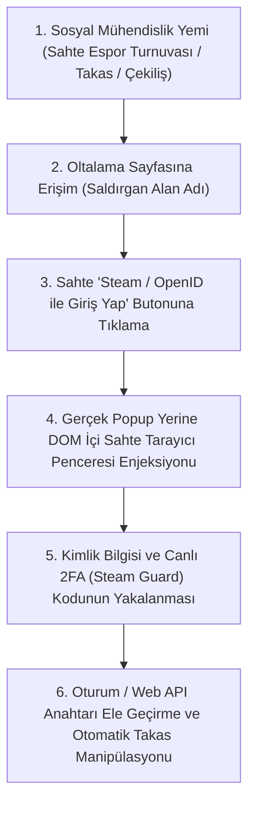

# 1. Tehdit ve Aldanma Analizi

## 1.1 Saldırı Vektörü: Tarayıcı İçi Tarayıcı (BitB) ve Sahte OpenID Akışı

Tarayıcı İçi Tarayıcı (**Browser-in-the-Browser / BitB**) oltalama saldırısı, ilk kez güvenlik araştırmacısı **mr.d0x** tarafından Mart 2022'de sistematik biçimde belgelenen bir istemci tarafı görsel aldatmaca tekniğidir. Bu yöntemde saldırgan, bir sistem veya tarayıcı zafiyetini istismar etmek yerine; kullanıcının zaten güvendiği **Tek Oturum Açma (SSO / OpenID / OAuth)** açılır pencere alışkanlığını hedef alır.

Oyun ve dijital varlık ekosistemlerinde (özellikle yüksek maddi değere sahip CS2/Dota 2 eşyalarının bulunduğu **Steam** hesaplarını hedef alan vakalarda) saldırganlar şu adım adım zinciri kurgular:

### Adım Adım Saldırı Kurulumu
1. **Hedefleme ve Yemleme (Lure):** Kurbanlara sohbet platformları (Steam sohbeti, Discord vb.) üzerinden sahte espor turnuvası oylaması, takım daveti, ücretsiz eşya çekilişi veya avantajlı takas bağlantıları gönderilir.
2. **Sahte OpenID Tetikleyicisi:** Meşru üçüncü parti oyun/takas siteleri gerçekten de "Steam ile Giriş Yap" (OpenID) akışını yeni bir açılır pencerede başlatır. Saldırgan sayfasındaki buton ise kullanıcıyı gerçek kimlik sağlayıcıya (IdP) yönlendirmek yerine JavaScript (`onclick`) ile mevcut sayfanın **DOM hiyerarşisi içinde** gizli duran bir `
` kapsayıcısını görünür hâle getirir.
3. **Bağlantı Önizleme (Hover) Aldatmacası:** Bazı saldırı kitlerinde bağlantının `href` niteliğine meşru görünümlü bir URL yerleştirilir, ancak tıklama olayı `event.preventDefault()` / `return false` ile iptal edilerek gerçek yönlendirme yerine sahte pencere açılır. Böylece fareyle butonun üzerine gelip sol alttaki önizlemeye bakan dikkatli kullanıcılar bile yanıltılabilir.
4. **Sahte Pencere ve `<iframe>` Gömmesi:** Saldırganın HTML/CSS ile çizdiği sahte pencerenin içine çoğunlukla saldırgan sunucusundaki klonlanmış giriş sayfasını yükleyen bir `<iframe>` veya doğrudan DOM içi giriş formu yerleştirilir. Arka plandaki sayfa yarı saydam bir katmanla pasifleştirilerek gerçek bir sistem penceresi açıldığı izlenimi güçlendirilir.
5. **Canlı 2FA Aktarımı ve Otomatik Takas İstismarı:** Kurban kullanıcı adı ve parolasını girdiğinde saldırgan arka ucu bilgileri gerçek platforma anlık olarak iletir; ardından sahte pencere dinamik biçimde **Steam Guard / 2FA** kodu ister. Ele geçirilen oturum ve Web API anahtarıyla kullanıcının gelecekteki takas teklifleri otomatik olarak iptal edilip saldırganın kontrolündeki sahte hesaplara yönlendirilebilir (*API Scam / Trade Hijacking*).

---

## 1.2 Görsel Aldanma Analizi: Kullanıcı Neden Aldanır?

Geleneksel güvenlik farkındalığı eğitimleri kullanıcılara yıllardır *"giriş yapmadan önce adres çubuğundaki alan adını ve HTTPS kilit simgesini kontrol edin"* kuralını öğretmiştir. BitB saldırısının tehlikeli olmasının temel nedeni, **tam olarak bu güvenlik refleksini saldırı yüzeyine dönüştürmesidir.**

- **Bilişsel Alışkanlık ve Hızlı Güven:** Kullanıcılar üçüncü parti platformlarda küçük bir SSO açılır penceresi görmeye alışıktır; bu nedenle ayrıntılı teknik inceleme yapmadan refleksif olarak kimlik bilgilerini girerler.
- **Kusursuz Tarayıcı Kromu Taklidi:** Saldırgan, kurbanın işletim sistemi ve tarayıcısını (`User-Agent` / CSS medya sorguları) tespit ederek Windows (`−`, `□`, `×`) veya macOS (kırmızı/sarı/yeşil trafik ışığı düğmeleri) tasarımına birebir uyan çerçeve, yazı tipi, gölge ve koyu/açık tema sunabilir.
- **Sahte Adres Çubuğu ve SSL Simgesi:** Adres çubuğunda gösterilen `https://...` metni ve kilit simgesi gerçek tarayıcı kromuna değil, saldırgan sayfasının HTML içeriğine aittir. Metnin seçilebilir veya salt okunur `<input>` şeklinde sunulması gerçekçiliği daha da artırır.

### Gerçek Tarayıcı Penceresi ile BitB Penceresinin Teknik Karşılaştırması

| İncelenen Özellik | Gerçek İşletim Sistemi / Tarayıcı Penceresi | BitB (DOM İçi Sahte Pencere) | Savunma / Tespit Açısından Anlamı |
| :--- | :--- | :--- | :--- |
| **DOM Hiyerarşisi** | Ana sayfanın DOM'undan tamamen bağımsız, ayrı tarayıcı penceresidir | Ana sayfanın DOM ağacındaki `position: fixed/absolute` bir kapsayıcıdır (`
`, `<section>` vb.) | İstemci eklentisi tarafından DOM taraması ile doğrudan incelenebilir |
| **Görünüm Alanı (Viewport) Sınırları** | Mevcut tarayıcı penceresinin dışına, masaüstüne veya ikinci monitöre sürüklenebilir | Ana sekmenin `viewport` sınırları içine hapsolur; kenara sürüklenince kesilir (clipping) | En ayırt edici davranışsal ve görsel farktır |
| **Adres Çubuğu ve TLS Kilit Simgesi** | Tarayıcı kromu tarafından üretilir; web sayfası JS/CSS ile değiştiremez | HTML metni, `<input>` ve statik SVG/Unicode simgeyle çizilir; gerçek `window.location.hostname` ile uyuşmaz | DOM içi URL metninin gerçek kaynak alan adıyla (`origin`) karşılaştırılması güçlü bir tespit sinyalidir |
| **Pencere Kontrolleri (`−`, `□`, `×`)** | İşletim sistemi pencere yöneticisi tarafından yönetilir; küçültme pencereyi görev çubuğuna indirir | HTML butonlarıdır; küçültme işlevsizdir veya yalnızca DOM öğesini gizler | Başlık bölgesinde birden fazla pencere kontrolü veya trafik ışığı kümesi şüpheli sinyal üretir |
| **Geliştirici Araçları (DevTools)** | Kendi bağımsız penceresinde ayrı DevTools oturumu açılır | Ana sekmede `F12` ile incelendiğinde sahte başlık çubuğu, adres kutusu ve `<iframe>` doğrudan görülür | Teknik doğrulama ve kanıt toplama aşamasında kesin ayrım sağlar |

---

## 1.3 Tehdit Modelleme: STRIDE ve MITRE ATT&CK (Savunma Perspektifi)

BitB saldırı zincirini sistematik biçimde savunabilmek için tehditler hem **STRIDE** tehdit modelleme çerçevesiyle hem de **MITRE ATT&CK** teknik kataloğuyla eşleştirilmiştir.

### STRIDE Eşleştirmesi

| STRIDE Kategorisi | Rol | BitB Bağlamında Tehdit Tanımı | Savunma / Azaltım Karşılığı |
| :--- | :---: | :--- | :--- |
| **Spoofing (Kimlik / Arayüz Taklidi)** | **Birincil** | Saldırgan; güvenilir kimlik sağlayıcının (örn. Steam OpenID) alan adını, TLS kilit simgesini ve tarayıcı açılır penceresini DOM içinde taklit eder. | DOM tabanlı BitB tespit eklentisi (sahte adres çubuğu + `origin` uyuşmazlığı + sahte pencere kromu kontrolü); protokol düzeyinde **FIDO2 / Passkey** (`origin` bağlama). |
| **Information Disclosure (Bilgi İfşası)** | İkincil | Kurbanın kullanıcı adı, parolası, canlı 2FA (Steam Guard) kodu ve oturum/API anahtarları saldırganın arka ucuna sızdırılır. | Parola yerine oltalamaya dirençli (phishing-resistant) MFA kullanımı; şüpheli DOM katmanında kullanıcıya anlık uyarı göstererek veri girişini engelleme. |
| **Tampering (Veri / İşlem Bütünlüğünü Bozma)** | İkincil | Ele geçirilen Web API anahtarı ve oturumla kullanıcının meşru takas teklifleri otomatik olarak değiştirilir veya saldırgan hesaplarına yönlendirilir. | Hesap/API anahtarı değişikliklerinde ek donanım onaylı doğrulama, API izinlerinin sınırlandırılması ve olağan dışı oturumların iptali. |

### MITRE ATT&CK Savunma Eşleştirmesi

| Teknik / Alt Teknik | Taktik | BitB Saldırısındaki Karşılığı | Savunma ve Tespit Yaklaşımı |
| :--- | :--- | :--- | :--- |
| **T1566 — Phishing** (`T1566.002` Spearphishing Link, `T1566.003` Spearphishing via Service) | Initial Access (`TA0001`) | Sahte turnuva, oylama veya takas bağlantılarının sohbet/topluluk servisleri (Steam Chat, Discord vb.) üzerinden kurbanlara iletilmesi. | İtibar/alan adı engelleme listeleri (CTI akışları), güvenli tarama filtreleri ve kullanıcıya gerçek `origin` bilgisini vurgulayan tarayıcı katmanı uyarıları. |
| **T1056 — Input Capture** (`T1056.002` GUI Input Capture, `T1056.003` Web Portal Capture) | Collection (`TA0009`) / Credential Access (`TA0006`) | Sahte tarayıcı arayüzü (`GUI`) ve içine gömülü klonlanmış giriş formu / `<iframe>` (`Web Portal`) üzerinden parola ile canlı 2FA kodunun yakalanması. | **İstemci Tabanlı DOM Denetimi (BitB Guard):** Yüzen kapsayıcı içindeki sahte URL çubuğu, pencere kontrol düğmeleri, gömülü `<iframe>` ve `<input type="password">` birleşimini yakalayarak kullanıcıyı anlık uyarma. **FIDO2 / WebAuthn:** Tarayıcı düzeyinde kriptografik `origin` doğrulaması ile sahte portalda kimlik doğrulamanın hiç gerçekleşmemesini sağlama. |

---

## 1.4 Kamuya Açık CTI Vakaları ve Kaynakça

Aşağıdaki kamuya açık teknik raporlar, BitB tekniğinin hem kavramsal temelini hem de oyun ekosistemindeki gerçek saldırı kullanımını belgelemektedir:

1. **mr.d0x (Mart 2022) — *Browser In The Browser (BITB) Attack*:**
   - **Özet:** HTML/CSS ve `<iframe>` kullanılarak Windows ve macOS tarayıcı pencerelerinin sayfa DOM'u içinde nasıl kusursuz taklit edilebileceğini ve `hover` URL önizlemesinin nasıl manipüle edildiğini ortaya koyan öncü teknik çalışma.
   - **Proje Katkısı:** Sahte pencere anatomisi, `viewport` sınır testi ve savunma sezgisellerinin teorik temeli.
2. **Group-IB CERT — Steam Hedefli BitB Oltalama Kitleri Analizi:**
   - **Özet:** Steam kullanıcılarını sahte turnuva, ücretsiz oyun ve takas vaatleriyle hedef alan BitB kitlerindeki artışı inceleyen CTI raporu. Sahte OpenID penceresinin arka planı kararttığı, kimlik bilgilerini anlık olarak gerçek servise iletip **Steam Guard 2FA** kodunu dinamik biçimde istediği ve ardından hesap/eşya hırsızlığı gerçekleştirdiği belgelenmiştir.
   - **Proje Katkısı:** Gerçek dünya oyun ekosistemi akışı ve 2FA'nın neden tek başına yeterli olmadığına dair kanıt.
3. **Silent Push — CS2 ve Espor Markalarını Kullanan BitB Kampanyaları:**
   - **Özet:** Profesyonel espor takımlarının ve CS2 topluluk etkinliklerinin taklit edilerek oyuncuların BitB tabanlı Steam giriş sayfalarına yönlendirildiğini izleyen tehdit istihbaratı bulguları.
   - **Proje Katkısı:** Güncel sosyal mühendislik yemlerinin (`T1566.003`) modellenmesi.

> **Rapor Notu (Ekran Görüntüleri):** Final rapor derlenirken yukarıdaki kamuya açık CTI raporlarından alıntılanan (kaynağı belirtilmiş) 1–2 örnek BitB ekran görüntüsü bu bölüme eklenebilir; geliştirilen sentetik test sayfalarında ise hiçbir gerçek marka veya logo kullanılmamıştır.

### Kaynakça
- mr.d0x, *"Browser In The Browser (BITB) Attack"*, mrd0x.com, Mart 2022.
- Group-IB CERT, *"Browser-in-the-Browser (BitB) Phishing Kits Targeting Steam Users"*, Group-IB Threat Intelligence Blog.
- Silent Push, *"Threat Intelligence Research on CS2 / Esports BitB Campaigns"*, Silent Push Blog.
- MITRE ATT&CK, *T1566 — Phishing*: https://attack.mitre.org/techniques/T1566/
- MITRE ATT&CK, *T1056 — Input Capture*: https://attack.mitre.org/techniques/T1056/

