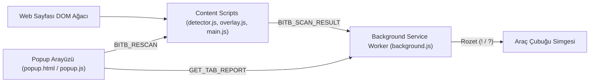

# 2. İstemci Tabanlı Tespit Eklentisi Mimarisi

## 2.1 Manifest V3 Tasarım İlkeleri ve Bileşen Yapısı

Geliştirilen **BitB Guard** tespit eklentisi, modern Chromium tabanlı tarayıcıların (Chrome, Edge, Brave) güvenlik modeli olan **Manifest V3** standartlarına uygun, harici bağımlılık ve derleme adımı gerektirmeyen yalın JavaScript ile tasarlanmıştır.

- **En Az Ayrıcalık İlkesi (Least Privilege):** Eklenti yalnızca aktif sekme etkileşimi için `activeTab` iznini ister; herhangi bir uzak sunucuya telemetri, URL veya kullanıcı verisi göndermez. Tüm DOM analizi **%100 istemci tarafında (yerel)** gerçekleştirilir.
- **İzole Bileşen İletişimi:** Tarayıcı eklentisi, güvenliği ve kararlılığı korumak amacıyla üç ayrı bağlamda çalışır ve `chrome.runtime` mesajlaşma arayüzü üzerinden haberleşir:

| Bileşen | Sorumluluğu |
| :--- | :--- |
| **`manifest.json`** | Manifest V3 yapılandırması, izinler ve içerik betiklerinin (`http`, `https`, `file`) enjeksiyon kuralları. |
| **`content/detector.js`** | DOM hiyerarşisini tarayan, yüzen aday pencereleri seçen ve 6 sezgisel sinyale göre `0–100` risk puanı üreten analiz motoru. |
| **`content/overlay.js` & `styles/alert.css`** | Şüpheli BitB penceresi algılandığında sayfanın üstünde kapatılabilir uyarı şeridi gösteren ve şüpheli öğeyi kesikli kırmızı çerçeveyle vurgulayan savunma arayüzü. |
| **`content/main.js`** | İlk sayfa yüklemesinde taramayı başlatan ve sonradan enjekte edilen sahte pencereleri yakalamak için `MutationObserver` çalıştıran giriş noktası. |
| **`background.js`** | Sekme bazlı (`tabId`) son tarama raporunu bellekte tutan ve eklenti simgesindeki uyarı rozetini (`!` kırmızı / `?` turuncu) güncelleyen Service Worker. |
| **`popup/`** | Kullanıcıya aktif sekmenin risk seviyesini, puanını, tetiklenen teknik sinyalleri ve manuel yeniden tarama (**Rescan Page**) düğmesini sunan arayüz. |

---

## 2.2 Sezgisel Tespit Motoru ve Puanlama Modeli

Tek bir görsel özelliğe dayanmak gerçek web sitelerinde yüksek **yanlış pozitif (False Positive)** oranına yol açacağından, motor **çoklu sinyal birleşimine (weighted heuristic scoring)** dayanmaktadır.

### Aday Seçimi (Görünüm Alanı ve Konum Filtresi)
Öncelikle sayfadaki görünür (`>= 200x150 px`), `position: fixed` veya `position: absolute` stiline sahip, tarayıcı görünüm alanı (`viewport`) sınırları içine sığan ve yüksek `z-index` (`>= 10`) veya gölge/kenarlık taşıyan kapsayıcılar aday olarak belirlenir. İç içe kapsayıcılarda yalnızca en dar iç pencere aday alınarak çift sayım önlenir.

### Sinyal Ağırlık Tablosu

| # | Tespit Sinyali | İncelenen Teknik Özellik | Puan |
| :-: | :--- | :--- | :-: |
| 1 | **Görünüm Alanı İçi Yüzen Kapsayıcı** | `fixed/absolute` konumlandırma, `viewport` içinde sınırlı pencere boyutları | `+10` |
| 2 | **DOM İçi Sahte Adres Çubuğu** | Aday pencerenin üst bölgesinde (`header`) `http(s)://...` biçiminde metin veya `<input>` bulunması | `+45` |
| 3 | **Kaynak Alan Adı (`origin`) Uyuşmazlığı** | Sahte adres çubuğundaki alan adının gerçek `window.location.hostname` değerinden farklı olması | `+25` |
| 4 | **Sahte İşletim Sistemi Pencere Kontrolleri** | Başlık çubuğunda **Windows** kontrol karakterleri (`−`, `□`, `×` — en az 2 düğme) **veya** yatay hizalanmış 3 dairesel **macOS trafik ışığı** düğmesinin tespit edilmesi | `+25` |
| 5 | **Gömülü `<iframe>` Denetimi** | Yüzen pencere kapsayıcısının içinde dış/satır içi (`src` / `srcdoc`) `<iframe>` bulunması | `+20` |
| 6 | **Kimlik Bilgisi Giriş Alanı** | Yüzen kapsayıcı içinde `<input type="password">` alanının bulunması | `+15` |

- **Puan Sınırı ve Risk Eşikleri:** Toplam puan en fazla `100` ile sınırlandırılır.
  - **`0 – 44` → Güvenli (`Safe`):** Uyarı gösterilmez.
  - **`45 – 69` → Şüpheli (`Medium`):** Turuncu uyarı şeridi ve `?` rozeti gösterilir.
  - **`70 – 100` → Yüksek Risk (`High`):** Kırmızı **BitB Phishing Alert** şeridi, kesikli kırmızı çerçeve ve `!` rozeti gösterilir.
- **Yanlış Pozitif Önleme Tasarımı:** Olağan web modallarında tek bir kapatma düğmesi (`×`) ve parola alanı sıklıkla birlikte bulunur. Bu nedenle tek `×` simgesi pencere kontrolü sayılmaz; böylece meşru bir yüzen giriş modalı yalnızca `10 + 15 = 25` puan alarak `45` eşiğinin altında kalır ve yanlış alarm üretmez.

---

## 2.3 Dinamik DOM İzleme (`MutationObserver`)

Gerçek BitB saldırılarında sahte pencere çoğu zaman sayfa ilk açıldığında değil, kullanıcı *"Giriş Yap"* butonuna tıkladığında veya kısa bir gecikmeyle DOM'a eklenir. `main.js` içindeki `MutationObserver`, belge gövdesindeki düğüm eklemelerini (`childList`) ve görünürlük değişimlerini (`style`, `class`, `hidden`) izleyerek **350 ms gecikmeli (debounced)** yeniden tarama tetikler. Eklentinin kendi oluşturduğu `#bitb-guard-banner` öğesi gözlem dışı bırakılarak sonsuz döngü engellenir.

---

## 2.4 Bilinen Sınırlar ve Geliştirme Alanları

İstemci tarafı sezgisel tespit güçlü bir **ek savunma katmanı (defense-in-depth)** sağlamakla birlikte, statik/sezgisel doğası gereği şu atlatma (evasion) senaryoları bilinçli olarak kayıt altına alınmıştır:

1. **Şemasız (`https://` içermeyen) Sahte Adres Çubukları:** Modern tarayıcılar adres çubuğunda `https://` önekini gizleyebilmektedir. Mevcut düzenli ifade `http(s)://` aradığından, şema gizlendiğinde URL sinyali tetiklenmez ve skor düşebilir (bu durum sentetik 4. test sayfası ile ayrıca ölçülmüştür).
2. **Görsel / `<canvas>` Tabanlı Sahte Arayüz:** Saldırganın adres çubuğu metnini HTML yerine doğrudan PNG görseli veya `<canvas>` olarak çizmesi hâlinde salt DOM metin denetimi yetersiz kalabilir.
3. **Kapalı (Closed) Shadow DOM:** Saldırganın sahte pencereyi kapalı bir Shadow Root içerisine gizlemesi standart `querySelectorAll` erişimini sınırlar.

Bu yapısal sınırlar, tarayıcı eklentisinin parola tabanlı sistemlerde önemli bir uyarı katmanı olduğunu ancak kesin ve kriptografik çözümün **Bölüm 4'te** incelenen **FIDO2 / Passkey** mimarisi olduğunu ortaya koymaktadır.
