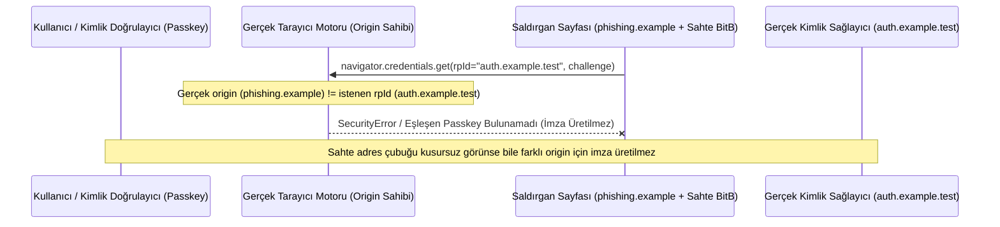

# 4. FIDO2 / WebAuthn / Passkey Analizi

## 4.1 Parola ve Klasik MFA'nın BitB ve MitM Karşısındaki Zayıflığı

Parola tabanlı kimlik doğrulama ve klasik çok faktörlü kimlik doğrulama (SMS OTP, TOTP uygulamaları veya Steam Guard kodu) ortak bir yapısal zayıflık taşır: **doğrulama güvenliği, kullanıcının doğru web sitesinde olduğunu görsel olarak fark etmesine dayanır.**

- **Paylaşılan Sır (Shared Secret) Sorunu:** Parola ve 6 haneli tek kullanımlık kodlar, kullanıcının klavyeden girdiği ham metin değerleridir; hangi alan adına (`origin`) gönderildiklerine dair kriptografik bir bağ taşımazlar.
- **BitB + AiTM (Adversary-in-the-Middle) Zinciri:** BitB saldırısında kullanıcı, DOM içine çizilen sahte adres çubuğuna aldanarak parolasını saldırgan sayfasına yazar. Saldırgan arka ucu bu bilgiyi gerçek servise anlık iletip gelen 2FA istemini sahte pencereye yansıttığında, kullanıcı tek kullanımlık kodunu da saldırgana teslim eder. Sonuç olarak klasik 2FA, görsel aldatmaca ve ortadaki adam saldırılarına karşı tek başına koruma sağlayamaz.

---

## 4.2 Kaynak Alan Adına Bağımlı (Origin-Bound) FIDO2 / Passkey Mimarisi

**FIDO2** (W3C **WebAuthn** + CTAP2 protokolleri) ve günlük kullanımdaki **Passkey** mimarisi, kimlik doğrulama güvenini kullanıcının görsel dikkatinden alıp **tarayıcı ile donanım/platform kimlik doğrulayıcısı arasındaki kriptografik protokole** taşır.

### Kesin Koruma Sağlayan Üç Teknik Mekanizma

1. **Asimetrik Açık Anahtar Kriptografisi:** Kayıt sırasında kullanıcının cihazında (Windows Hello, Touch ID, güvenlik anahtarı vb.) bir açık/özel anahtar çifti üretilir. Özel anahtar cihazı asla terk etmez; sunucu yalnızca açık anahtarı saklar ve her oturumda rastgele bir sorgu (*challenge*) imzalatır.
2. **Relying Party ID (`rpId`) Eşleşmesi:** Her passkey yalnızca oluşturulduğu alan adına (`rpId`, örn. `auth.example.test`) bağlıdır. Saldırgan sayfası (`phishing.example`) gerçek sitenin `rpId` değerini talep ettiğinde tarayıcı **WebAuthn güvenlik politikası** gereği çağrıyı doğrudan reddeder; saldırgan kendi alan adını (`phishing.example`) kullansa bile kullanıcının gerçek siteye ait anahtarı bu alan adıyla eşleşmez.
3. **Tarayıcı Tarafından İmzalanan `clientDataJSON` ve `origin` Bağlama:** Kimlik doğrulama sırasında gerçek tarayıcı (sayfa içindeki sahte BitB penceresi değil), aktif sekmenin gerçek kaynağını (`origin`) ve sorgu değerini (`challenge`) `clientDataJSON` yapısına yerleştirir ve doğrulayıcı bu verinin özetini özel anahtarla imzalar. Ortadaki adam (**MitM / AiTM**) saldırganı trafiği gerçek sunucuya aktarsa bile, sunucu imzanın içindeki `origin` alanının kendi alan adıyla uyuşmadığını kriptografik olarak tespit eder ve oturumu reddeder.

---

## 4.3 Karşılaştırmalı Savunma Değerlendirmesi (Derinlemesine Savunma)

| Karşılaştırma Kriteri | Parola + Klasik 2FA (SMS / TOTP) | İstemci Tespit Eklentisi (BitB Guard) | FIDO2 / WebAuthn / Passkey |
| :--- | :--- | :--- | :--- |
| **Güven Dayanağı** | Kullanıcının URL'yi görsel olarak doğrulaması | Tarayıcı içi sezgisel DOM ve pencere analizi | Tarayıcı + kriptografik `origin` / `rpId` bağlama |
| **BitB Görsel Aldatmacasına Direnç** | **Düşük** (sahte adres çubuğu ile aşılır) | **Yüksek** (sahte krom ve URL uyuşmazlığını uyarır; ancak kenar durumlarda atlatma riski vardır) | **Kesin** (görsel arayüzden tamamen bağımsızdır) |
| **Canlı MitM / AiTM Proxy Direnci** | **Düşük** (2FA kodu anlık aktarılabilir) | **Orta** (yalnızca BitB arayüz taklidini yakalar; tam sayfa ters vekil saldırılarını kapsamaz) | **Kesin** (`clientDataJSON.origin` sunucuda doğrulanır) |
| **Mevcut Web Ekosistemiyle Uyumluluk** | Tüm sitelerde geçerli | Parola / OpenID kullanan mevcut sitelerde ek koruma sağlar | Yalnızca WebAuthn / Passkey destekleyen platformlarda çalışır |

### Sonuç: Eklenti ile Passkey Birlikte Neden Anlamlıdır?
**FIDO2 / Passkey**, BitB ve AiTM oltalama saldırılarına karşı protokol düzeyinde **kesin ve kalıcı çözümdür**. Ancak oyun ve üçüncü parti OpenID ekosistemleri de dâhil olmak üzere tüm web servislerinin parola tabanlı girişten tamamen geçişi zaman almaktadır. Bu geçiş sürecinde **BitB Guard** gibi istemci tabanlı DOM tespit eklentileri, henüz Passkey desteklemeyen sitelerde kullanıcıyı görsel aldatmacalara karşı koruyan önemli bir **derinlemesine savunma (defense-in-depth)** katmanı işlevi görmektedir.

### Kaynakça
- W3C, *Web Authentication: An API for accessing Public Key Credentials (WebAuthn Level 2/3)*: https://www.w3.org/TR/webauthn-2/
- FIDO Alliance, *FIDO2 / Passkeys Technical Overview*: https://fidoalliance.org/fido2/
